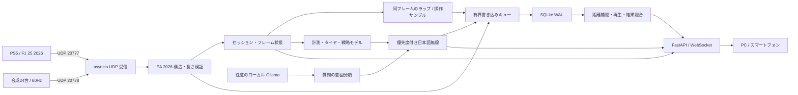

# システムアーキテクチャ

- 受信と最新状態の更新は単一イベントループで行います。24台分の最大約10 Hzサンプルを保存し、元のUDPは別に保存します。SQLite書き込みは有界キュー経由のスレッドでまとめてコミットします。DB書き込み失敗とキューあふれは接続画面に出ます。
- WebSocketは最新スナップショットを最大10 Hzで配信します。遅い接続には送信タイムアウトを適用します。履歴グラフは件数を制限して取得します。ブラウザの切断時やUDPが停止した場合は音声を中断します。
- 新しいUIDは独立した記録です。フラッシュバック時は同じ記録の新しい epoch に移り、比較・推定・無線状態をリセットします。アーカイブの経過秒は受信側の時計、ラップ差はゲーム側のラップ時刻を使います。
- マップは Motion から受信した X/Z と、ラップ距離の分かる走行点から構成します。サンプルの距離が離れている場所は線をつなぎません。タイムデルタは両ラップの有効な観測区間内で補間し、長い欠損を跨ぎません。
- 有効ラップの増加に伴い、同一スティントのペース勾配と最大摩耗勾配を推定します。ピット候補は基準・早期・延長の3種類です。今周の復帰順位は同じ周回にいる後方車の連続したギャップが得られる場合に計算します。将来周回の復帰順位はN/Aです。
- オンラインで共有が制限された車両の燃料・ERS・ダメージは表示用の状態から除外します。アーカイブの生UDPはゲームが送信した内容を保持します。
- 高度な言語処理は任意の localhost Ollama 意図分類に限定し、テレメトリーや計算結果をモデルへ渡しません。分類タイムアウト時も受信と戦略計算は続きます。
